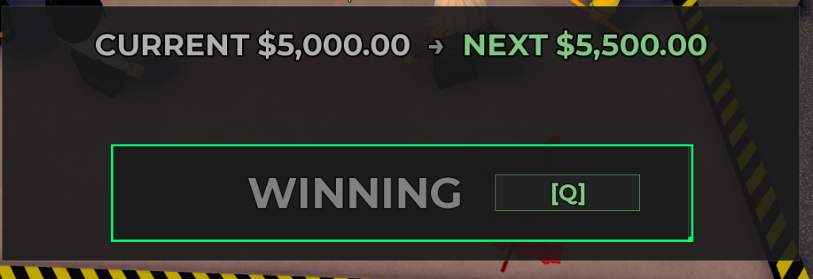

# Storage Hunter Auto Bid Roblox

[](https://www.python.org/)
[](LICENSE)
[](https://www.microsoft.com/windows)

A fast, ultra-low-latency screen-based timing macro controller for **Roblox: Storage Hunter** and similar auction games. Auto Bid detects on-screen visual outline state changes and fires your bid keypress with sub-millisecond precision.

---

## 🎯 How to Use: Keybinds & Sniper ROI Setup Guide

Follow this guide to set up and calibrate the macro for 100% reliable auto-bidding:

<p align="center">
  
</p>

### 1. Match Your Keybinds
1. **In Roblox**: Check or bind your in-game bid action to a keyboard key (for example, **`Q`** as shown on the `WINNING [Q]` button).
2. **In the Macro**: In the macro window, set the **Key** field to the exact same key (e.g., `q`).

### 2. Position the Sniper ROI Frame
1. Launch the macro (`python auto_bid_v2_1.py`).
2. A green targeting frame with cyan corner brackets will appear on screen.
3. **Drag and resize** the green box so that it snugly frames the entire bid button (`WINNING [Q]` / `BID [Q]`), exactly as illustrated in the screenshot above:
   * **Top Border**: Placed right along the top edge of the bid button.
   * **Bottom Border**: Placed right along the bottom edge of the bid button.
   * **Left & Right Borders**: Snugly aligned with the left and right ends of the button.
4. Ensure the button's outer border sits directly within the macro's edge-detection sampling band.

### 3. How the Detection Works
* When an auction round begins or when an opponent outbids you, the button outline border flashes/updates visually.
* The macro samples the thin border band around the box edge every **1–2 milliseconds** using a Windows high-resolution multimedia timer (`timeBeginPeriod(1)`).
* The moment the edge pixels trigger, the macro sends the configured bid keystroke instantly, placing your bid before human players can react.

### 4. Arming the Macro
* Click **Start** (or press the toggle hotkey) to arm the macro.
* The status will display active monitoring. Keep the Roblox game window visible on screen.
* When you want to pause or stop, click **Stop** or press the toggle hotkey.

---

## Core Versions & Features

This repository includes three tailored controllers to suit different game mechanics:

### 1. `auto_bid_v2_1.py` (Recommended: Ultra-Low Latency)
* **Outline Detection Engine**: Samples thin border bands around the selected panel edge.
* **1ms Windows Multimedia Timer**: Activates `timeBeginPeriod(1)` only while the macro is running.
* **Deadline Scheduling**: Eliminates sleep drift and prioritizes screen capture over UI updates.
* **Target Polling**: Capable of down to 1–2 ms scan intervals.

### 2. `auto_bid_v2.py` (Outline Trigger with Visual Tuning)
* Movable transparent HUD with real-time edge pixel counter.
* Visual slider adjustments for edge margin and threshold calibration.

### 3. `auto_bid.py` (Timing Bar & Slider Overlap)
* Designed for slider mini-games (e.g., fishing, auction biddings, lock-picking).
* Detects saturated green target zones and moving white indicator bars.
* Automatically triggers the keystroke when the indicator aligns with the target zone.

---

## Requirements

* **Operating System**: Windows 10 or 11 (64-bit)
* **Python**: Python 3.10+
* **Dependencies**:
  * `mss`: High-performance screen capture
  * `numpy`: Fast vectorized pixel array operations
  * `pynput`: Direct keyboard injection & global hotkeys
  * `Pillow`: Image processing utilities

---

## Installation

1. **Clone the repository**:
   ```bash
   git clone https://github.com/millonova/Storage-Hunter-Auto-Bid-Roblox.git
   cd Storage-Hunter-Auto-Bid-Roblox
   ```

2. **Create and activate a virtual environment (optional)**:
   ```powershell
   python -m venv venv
   .\venv\Scripts\Activate.ps1
   ```

3. **Install dependencies**:
   ```powershell
   pip install -r requirements.txt
   ```

---

## Settings & Configuration

Settings are saved automatically in `settings/`:
* `settings/auto_bid_settings.json`
* `settings/auto_bid_v2_settings.json`
* `settings/auto_bid_v2_1_settings.json`

Example configuration:
```json
{
  "left": 6,
  "top": 7,
  "width": 808,
  "height": 136,
  "key": "q",
  "poll_ms": 2,
  "cooldown_ms": 150,
  "minimum_edge_pixels": 550,
  "edge_band_px": 12,
  "always_on_top": true
}
```

---

## License

This project is licensed under the **MIT License** - see the [LICENSE](LICENSE) file for details. Free for personal and educational use.

---

## ⚠️ Disclaimer

Use this automation software only where permitted by the rules and terms of service of the relevant application or game. The creators accept no responsibility for account bans or penalties resulting from misuse.
